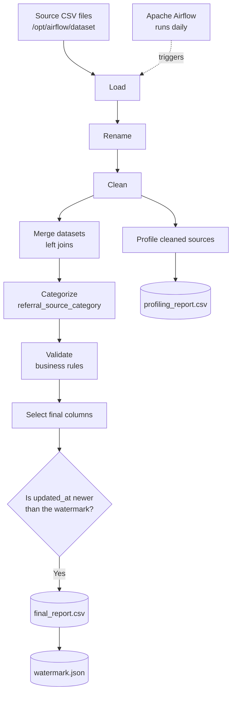

# Referral Data Engineering Pipeline

An automated ETL pipeline that consolidates referral, user, lead, reward, and payment data into a single referral dataset, flags each referral as valid or invalid using business rules, and profiles the source data. It is built with **Python and Pandas** and scheduled with **Apache Airflow** inside a **Docker** container.

## Table of contents

- [Quick start](#quick-start)
- [Project objectives](#project-objectives)
- [Architecture](#architecture)
- [Technology stack](#technology-stack)
- [Project structure](#project-structure)
- [Source datasets](#source-datasets)
- [ETL workflow](#etl-workflow)
- [Business-rule validation](#business-rule-validation)
- [Incremental loading](#incremental-loading)
- [Data profiling](#data-profiling)
- [Airflow orchestration](#airflow-orchestration)
- [Setup and execution](#setup-and-execution)
- [Output files](#output-files)
- [Configuration notes](#configuration-notes)
- [Troubleshooting](#troubleshooting)
- [Known limitations](#known-limitations)
- [Future improvements](#future-improvements)
- [Documentation](#documentation)

## Quick start

```bash
# 1. Put the 7 source CSV files in dataset/
# 2. Build the image (from the project root)
docker build -t referral-data-pipeline:3.3.2 .

# 3. Start Airflow, mounting output/ so results persist on your machine
mkdir -p output
docker run --rm -p 8080:8080 \
  --user root \
  -v "$(pwd)/output:/opt/airflow/output" \
  referral-data-pipeline:3.3.2 standalone
```

Then open <http://localhost:8080>, sign in with the credentials printed in the container logs, and trigger the `referral_data_pipeline` DAG. Results appear in `output/`. Windows PowerShell users: see [Setup and execution](#setup-and-execution).

## Project objectives

- Consolidate referral information from multiple source CSV files.
- Standardize dates, text fields, identifiers, and missing values.
- Remove duplicate records using selected business identifiers.
- Enrich referrals with lead, user, transaction, status, and reward information.
- Apply business rules to decide whether each referral is valid.
- Support incremental reporting through an `updated_at` watermark.
- Generate a profiling report to inspect source-data quality.
- Schedule execution with Apache Airflow.

## Architecture



## Technology stack

| Technology | Purpose |
| --- | --- |
| Python | ETL implementation |
| Pandas | Data loading, cleaning, joining, and reporting |
| NumPy | Referral-source categorization |
| Apache Airflow 3.3.2 | Workflow scheduling and orchestration |
| BashOperator | Runs the permission command and the transformation script |
| Docker | Packages the Airflow environment and project files |
| JSON | Stores the incremental-load watermark |
| CSV | Source data and generated reports |

## Project structure

Expected layout, based on the Dockerfile and DAG paths:

```text
referral-data-pipeline/
├── dags/
│   └── referral_data_pipeline.py
├── src/
│   └── transform.py
├── dataset/
│   ├── lead_log.csv
│   ├── paid_transactions.csv
│   ├── referral_rewards.csv
│   ├── user_logs.csv
│   ├── user_referral_logs.csv
│   ├── user_referral_statuses.csv
│   └── user_referrals.csv
├── output/
│   ├── final_report.csv
│   ├── watermark.json
│   └── profiling_report.csv
├── requirements.txt
├── Dockerfile
├──docker-compose.yaml
└── README.md
```

## Source datasets

The pipeline reads seven CSV files from `/opt/airflow/dataset`. **All seven are required** by `load_data()`.

| Dataset | Role in the pipeline |
| --- | --- |
| `lead_log.csv` | Lead details used to enrich referee information |
| `paid_transactions.csv` | Transaction details and payment status |
| `referral_rewards.csv` | Referral reward values and creation dates |
| `user_logs.csv` | Referrer details such as name, phone number, and home club |
| `user_referral_logs.csv` | Referral log information |
| `user_referral_statuses.csv` | Referral status descriptions |
| `user_referrals.csv` | Main referral records and relationship keys |

## ETL workflow

The transformation lives in `src/transform.py` and runs in this order:

| Step | Stage | What happens |
| --- | --- | --- |
| 1 | **Load** | Reads the seven CSV files with Pandas. Missing files, empty files, and parsing errors are raised. |
| 2 | **Rename** | Renames selected identifiers and creation-date columns to clearer names. |
| 3 | **Clean** | Converts date columns to UTC, drops records missing selected identifiers, removes duplicates, standardizes selected text columns, and fills certain missing values. |
| 4 | **Merge** | Left-joins the main referral records with leads, referral logs, paid transactions, user details, statuses, and rewards. |
| 5 | **Categorize** | Derives `referral_source_category` from `referral_source`: `Online` for `User Sign Up`, `Offline` for `Draft Transaction`, otherwise the lead's `source_category`. |
| 6 | **Validate** | Applies the business rules and creates the validity result. |
| 7 | **Select** | Renames output fields and keeps the defined final columns. |
| 8 | **Incremental append** | Appends records whose `updated_at` is newer than the saved watermark. |
| 9 | **Profile** | Generates a profiling report for the cleaned source datasets. |

## Business-rule validation

The pipeline creates two output fields: `is_business_logic_valid` and `validity`.

### Valid successful referrals

A successful referral is valid when **all** of these hold:

- Reward value is greater than zero.
- Referral status description is `Berhasil`.
- A transaction ID exists.
- Transaction status is `Paid`.
- Transaction type is `New`.
- The transaction occurs after the referral date.
- The transaction and referral occur in the same calendar month.
- Membership expiry date is on or after the transaction date normalized to midnight.

### Valid unsuccessful referrals

An unsuccessful referral is valid when:

- The status description is `Menunggu` or `Tidak Berhasil`, **and**
- Reward value is missing or equal to zero.

### Invalidating conditions

A record is marked invalid when **any** of these apply:

- A reward exists but the status is not `Berhasil`.
- A reward exists but the transaction ID is missing.
- There is no reward, but a paid transaction exists that occurs after the referral date.
- The status is `Berhasil` but there is no reward.
- The transaction date is before the referral date.

### Final decision

`is_business_logic_valid` is true only when the record meets a valid successful **or** valid unsuccessful condition **and** meets none of the invalidating conditions.

> These rules describe what is currently encoded in `validate_business_logic()`. Review them with the business owner before using the output for financial or operational decisions.

## Incremental loading

The pipeline uses `updated_at` as its watermark.

- The watermark is stored in `watermark.json`.
- If the file does not exist, the pipeline starts from the earliest supported timestamp.
- Records with `updated_at` greater than the saved watermark are selected and appended to `final_report.csv`.
- The watermark is then set to the maximum `updated_at` among the appended records. It is updated **only after** a successful CSV append.

> **Note:** This is a timestamp-based append, not an upsert. See [Known limitations](#known-limitations) for the consequences.

## Data profiling

The pipeline writes `profiling_report.csv` for the seven cleaned source datasets. For each column it records:

| Metric | Description |
| --- | --- |
| Table name | Source dataset |
| Column name | Column being profiled |
| Data type | Pandas data type |
| Null count | Number of missing values |
| Percentage populated | Share of non-null values |
| Distinct values | Count of unique values |
| Minimum / maximum | Smallest and largest observed values |
| Max string length | Longest observed string |

Before writing a new report, the script deletes files matching `profiling_report*.csv` in the output directory.

## Airflow orchestration

| Setting | Value |
| --- | --- |
| DAG ID | `referral_data_pipeline` |
| Start date | 1 October 2026 |
| Schedule | `@daily` |
| Catchup | Disabled |
| Tags | `referral`, `data-engineering` |

The DAG has two tasks, chained as `set_permissions >> transform`:

1. **`set_permissions`** runs `chmod -R 777 /opt/airflow/output`.
2. **`transform`** runs `python /opt/airflow/src/transform.py`.

> `chmod 777` gives every user read, write, and execute access to the output directory. That is convenient locally but too permissive for production, where an owner/group model is preferable.

## Setup and execution

### Prerequisites

- Docker installed and running.
- The project source files and the seven source CSV files.
- Enough disk space for the Docker image and generated reports.

### 1. Build the image

From the project root:

```bash
docker build -t referral-data-pipeline:3.3.2 .
```

### 2. Start Airflow

**macOS / Linux:**

```bash
docker run --rm -p 8080:8080 \
  -v "$(pwd)/output:/opt/airflow/output" \
  referral-data-pipeline:3.3.2 standalone
```

**Windows PowerShell:**

```powershell
docker run --rm -p 8080:8080 `
  -v "${PWD}/output:/opt/airflow/output" `
  referral-data-pipeline:3.3.2 standalone
```

The host `output/` folder is mounted into the container so reports and the watermark survive after the container stops. Make sure the folder exists and is writable by the container user.

### 3. Run the DAG

1. Open <http://localhost:8080> and sign in with the credentials printed by the container.
2. Find `referral_data_pipeline` and make sure it is enabled.
3. Trigger it manually for a first test, or wait for the daily schedule.

### 4. Check the results

Inspect the host `output/` folder (see [Output files](#output-files)).

## Output files

| File | Description |
| --- | --- |
| `final_report.csv` | Consolidated referral dataset with validity flags, appended incrementally |
| `watermark.json` | Latest `updated_at` already appended, used for the next run |
| `profiling_report.csv` | Column-level data-quality profile of the cleaned source datasets |

## Configuration notes

- Keep the source CSV files in `dataset/` **before building the image**, because the Dockerfile copies that folder into the image.
- The Dockerfile copies `dags/`, `src/`, and `dataset/` into `/opt/airflow`.
- The Dockerfile copies `requirements.txt` but installs packages explicitly in the `RUN pip install` command. To manage dependencies through `requirements.txt`, install from that file instead.
- Keep the output path consistent across `transform.py`, the DAG, and the Docker volume mount.
- Do not commit sensitive or confidential source data to a public repository.

## Troubleshooting

| Problem | What to check |
| --- | --- |
| DAG does not appear | The DAG file is in `dags/`; check Airflow DAG import errors |
| CSV file not found | All seven files are in `dataset/` and were copied into the image (rebuild after adding them) |
| Permission denied | Output path, directory ownership, and mounted-volume permissions |
| Missing column / `KeyError` | Source CSV headers against the columns the transformation expects |
| Date conversion error | Source date values and formats |
| Merge error | Join keys and source column names |
| No new records appended | `updated_at` values against `watermark.json` |
| Container output disappears | The host output folder is mounted to the same container path the script uses |

## Known limitations

- **Not idempotent:** an existing referral that is updated later can be appended again as a new row, so `final_report.csv` may contain several versions of one referral.
- **Skipped ties:** the watermark filter uses `>` rather than `>=`, so records sharing the exact watermark timestamp may be skipped on a later run.
- **Broad permissions:** the DAG sets `777` on the output directory.
- **Baked-in data:** source CSVs are copied into the image at build time, so new data requires a rebuild unless `dataset/` is mounted as a volume.

Consider a stable tie-breaker or an upsert/deduplication strategy if the first two cases matter for your use.

## Future improvements

- Add automated tests for cleaning, joins, and business rules.
- Add explicit schema and data-quality checks before merging.
- Make incremental processing idempotent and handle late-arriving updates.
- Add structured logging and task-level metrics.
- Move configuration (paths, etc.) into environment variables.
- Replace `777` permissions with least-privilege access.
- Add failure notifications.

